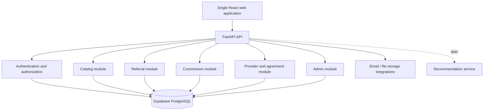

# Affiliate Referral Platform
## MVP Product Requirements Document (PRD) & Architecture Plan

**Version:** 0.2 — Draft for discussion  
**Date:** 11 October 2026  
**Product theme:** *Monetize Your Network & Influence*  
**Status:** Preparation document; business rules require review before implementation.

> **Key product decision:** Build one web application with role-based experiences for **Affiliate**, **Provider**, and **Admin**. The provider experience is a module inside the same application, not a separate app. The MVP focuses on approved service listings, simple referrals, and auditable commission tracking.

## 1. Executive summary

The platform is one responsive web application with three roles: **Affiliate, Provider, and Admin**. Providers use the same app to maintain their business profile, publish service offerings, enter customer prices, and configure the referral fees they are willing to pay for different qualifying events. Admins approve providers and offerings, verify lead qualification or conversions, manage affiliate reward rules, and record payouts.

The Affiliate role supports two earning models:

- **Lead Generator:** submits a potential customer and earns when the lead is reviewed and accepted as qualified under the offering's rules. The reward does not depend on a later sale.
- **Lead Converter:** works on an assigned opportunity and earns when the agreed conversion event is verified.

An affiliate may select one model or declare that they can work in both models. For each referral, the selected earning model and its applicable reward terms must be explicit. In the MVP, one referral has one earning model and one earning affiliate; paying both a lead generator and a separate converter for the same customer is an open policy decision and is not assumed by default.

The product should feel approachable to people who do not have a sales or marketing background. Its primary navigation is:

- **Navigate by Service** — start from what a contact may need.
- **Navigate by Provider** — start from a known business/provider.
- **My Referrals** — review submitted referrals and the relevant lead/conversion stage.
- **My Commissions** — understand rewards pending, approved, paid, or adjusted.

A lightweight **My Contacts** feature can be added after the core referral flow is stable. AI recommendations are not required for the first release; basic category, keyword, and location matching is sufficient to start.

## 2. Product vision and problem statement

### Vision

Help anyone with a network — student, homemaker, professional, business owner, or retired person — discover relevant offerings and earn according to the work they choose to do: generating a qualified lead or helping convert a lead into a customer.

### Problem to solve

Potential affiliates may have useful networks but may not know which services exist, what they cost, or how they can earn from a referral. Some affiliates are comfortable introducing a qualified lead but do not want to manage follow-up; others are willing to work toward a conversion. Providers need to state the reward they will pay for a qualified lead, a successful conversion, or both. The company needs to control eligibility, attribution, approvals, and financial records in one auditable system.

### Product principles

1. One web app with role-based navigation, not separate apps for each role.
2. Browse by service or provider; both paths converge on the same offering and referral form.
3. Show approved service price and the affiliate's actual payable commission clearly.
4. A provider may submit service and pricing details, but listings become visible to affiliates only after required checks and approval.
5. Never silently change historical referral or commission amounts when a provider edits an offering.
6. Support separate lead-generation and conversion-based earning models without creating separate account systems.
7. Keep the MVP rule-based and operationally simple; add AI only after usage data proves it is useful.

## 3. Goals, non-goals, and MVP boundaries

### MVP goals

- Give affiliates a simple signup/login and profile experience.
- Let affiliates browse approved offerings by service and provider, with search and basic location filtering.
- Let providers create and edit service offerings, prices, service areas, and separate fee amounts for a qualified lead and/or a verified conversion.
- Let affiliates choose their earning capability: Lead Generator, Lead Converter, or Both.
- Let affiliates submit a referral using one consistent form, with the earning model clearly selected.
- Let providers review assigned referrals and report lead qualification or conversion outcomes.
- Let admins approve providers/listings, verify qualified leads and conversions, manage reward rules, and record payouts.
- Give affiliates transparent referral, lead/conversion, and commission histories.
- Preserve a clear audit trail for offer changes, referral status changes, and financial records.

### Not in the first release

- Separate native iOS/Android apps.
- Microservices or complex event-driven infrastructure.
- AI-based personality scoring or autonomous referrals.
- Automated WhatsApp campaigns or broad CRM capabilities.
- Complex multi-level affiliate trees, team downlines, or leaderboards.
- Automated bank disbursements unless separately approved and integrated.
- Full digital-signature integration as a launch blocker. Initially, an admin may record agreement status and attach/store the signed agreement; e-sign integration can follow.

## 4. User roles and access model

| Role | Primary needs | Can do | Cannot do |
|---|---|---|---|
| **Affiliate** | Choose an earning model and refer suitable opportunities | Manage own profile and earning-mode preference; browse active offerings; submit and track referrals; view own commissions; maintain own contacts if enabled | Publish providers/offers; change reward rules; approve qualification/conversion or payouts; view another affiliate's private data |
| **Provider** | Publish offerings and define referral fees for the work/outcome they want to reward | Manage own provider profile; draft/edit own offerings; set service price, service area, qualified-lead fee and/or conversion fee; see assigned referrals; report outcomes; view own offering/referral history | Activate own offers without required approval; change the company's affiliate reward-share policy; view another provider's data; approve company payouts |
| **Admin (company)** | Control quality, economics, and operations | Approve providers and offerings; manage service taxonomy; define affiliate share rules; review referrals and conversions; approve/record payouts; manage user access and audit records | Bypass audit history or alter paid financial records without a compensating adjustment record |

### Onboarding approach (proposed)

- Affiliates can self-register; account status may be active or pending according to the anti-fraud policy.
- Providers can be invited by admin or register and await approval.
- Admin accounts must be provisioned securely, not created through public self-signup.
- A provider account unlocks the provider dashboard within the same application.

### Affiliate earning models (important distinction)

The account role remains **Affiliate**. Earning model is a profile capability and a per-referral choice, not a separate login role:

| Earning model | What the affiliate does | Reward trigger | Conversion required? |
|---|---|---|---|
| **Lead Generator** | Introduces a potential customer and submits the necessary details | Lead is verified and accepted as qualified | No, unless the specific approved offer terms explicitly require it |
| **Lead Converter** | Works on an opportunity through follow-up/coordination and helps secure the customer | A qualifying conversion is verified | Yes |
| **Both** | Can participate in either model | Depends on the model selected for each referral | Depends on the selected model |

Providers can enable one or both reward events on an offering. An affiliate may select only a reward model that is enabled for that offering and included in their profile capabilities. The MVP assigns one earning model and one earning affiliate to a referral. Paying both a lead generator and a separate converter for the same contact needs an explicit future attribution policy.

## 5. Navigation and core screens

### Affiliate navigation

1. **Home** — summary of referrals and commission status; shortcuts to both discovery routes.
2. **Explore** — tabs for *By Service* and *By Provider*.
3. **Offering details** — provider, service name, description, location/service area, price, enabled earning models, and the affiliate's exact reward for a qualified lead and/or verified conversion.
4. **Refer someone** — shared form with selected service/offering prefilled.
5. **My Referrals** — referral ID, provider/offering, date, status, and outcome.
6. **My Commissions** — lead-generation rewards and conversion rewards, each shown as pending, approved, paid, adjusted, or reversed, plus payout history.
7. **Profile** — occupation, network types, interests, preferred location, contact information.
8. **My Contacts (small enhancement)** — save contacts with a lawful basis/permission and view possible offering matches.

### Provider navigation

1. **Provider Home** — listing status, recent referrals, and actions requiring attention.
2. **My Services & Offerings** — create/edit offerings and view approval status.
3. **Pricing & Referral Fees** — service price; fixed provider fee for an accepted qualified lead and/or fixed provider fee for a verified conversion; enabled reward models.
4. **Referrals Received** — view assigned referrals and report progress/outcome.
5. **Provider Profile** — business details, locations/service areas, logo, and contact details.
6. **Agreement Status** — view the current agreement status and relevant terms/documents if enabled.
7. **Reward Setup** — configure a fixed provider fee for an accepted qualified lead, a separate fixed provider fee for a verified conversion, or both.

Provider reward setup must show qualification criteria for each enabled event. For example, a lead fee may require valid contact details and provider acceptance; a conversion fee may require a completed purchase/payment. These criteria must be explicit and approved.

### Admin navigation

1. Overview.
2. Affiliates and providers.
3. Service catalog and category/synonym management.
4. Offering review queue.
5. Provider agreements.
6. Referrals and conversion verification.
7. Commission rules and ledger.
8. Payout records.
9. Audit log and configuration.

## 6. Functional requirements

Priority definitions: **P0** = required for MVP launch; **P1** = include if time allows after core flow; **P2** = later enhancement.

### 6.1 Affiliate requirements

| ID | Priority | Requirement | Acceptance criteria |
|---|---|---|---|
| AF-01 | P0 | Sign up, log in, recover account | An affiliate can authenticate and access only affiliate-authorized screens. |
| AF-02 | P0 | Complete a basic profile and choose earning capability | Affiliate can choose Lead Generator, Lead Converter, or Both; occupation, network types/interests, and preferred area can be entered or skipped where optional. |
| AF-03 | P0 | Browse by Service | Active offerings can be found through category, keyword, and basic synonyms. |
| AF-04 | P0 | Browse by Provider | Providers appear as brand/logo cards where available; selecting a provider lists only active offerings. |
| AF-05 | P0 | See offer economics by earning model | Offering details clearly show the reward for an accepted qualified lead and/or a verified conversion, as applicable to the affiliate's selected mode. |
| AF-06 | P0 | Submit a referral | One consistent form captures the selected offering and necessary customer details; a unique referral ID is created. |
| AF-07 | P0 | Track referrals | The affiliate can see status changes and final outcomes for their own referrals. |
| AF-08 | P0 | Track both reward types | The affiliate can distinguish lead-generation rewards from conversion rewards and see pending, approved, paid, adjusted, or reversed entries. |
| AF-09 | P1 | Manage My Contacts | Affiliate can add, update, and remove their own contacts under agreed privacy rules. |
| AF-10 | P1 | View suggested offerings | The platform suggests offerings using declared contact/profile fields and explains the match. No referral is submitted automatically. |

### 6.2 Provider requirements

| ID | Priority | Requirement | Acceptance criteria |
|---|---|---|---|
| PR-01 | P0 | Access provider portal in the same app | A provider logs in and sees provider-specific navigation, not affiliate/admin controls. |
| PR-02 | P0 | Manage provider profile | Provider can maintain permitted business details, logo, address, and service area. |
| PR-03 | P0 | Create an offering and configure reward events | Provider can enter service/category, offering name, description, price, service area, and optionally configure a fixed fee for an accepted qualified lead and a separate fixed fee for a verified conversion. |
| PR-04 | P0 | Edit offering | Provider can update a draft or submit a change for review; edits do not overwrite terms used by existing referrals. |
| PR-05 | P0 | Understand approval status | Provider can see draft, pending review, active, rejected, or paused status and any admin feedback. |
| PR-06 | P0 | Review assigned referrals | Provider can view only referrals routed to their offerings and necessary contact information. |
| PR-07 | P0 | Report lead and conversion outcomes | Provider can mark whether a lead is qualified, report follow-up progress, and report conversion outcome; admin verification follows the agreed policy. |
| PR-08 | P1 | View offering/referral performance | Provider can view basic counts for active offerings and referral outcomes. |

### 6.3 Admin requirements

| ID | Priority | Requirement | Acceptance criteria |
|---|---|---|---|
| AD-01 | P0 | Manage users and roles | Admin can approve/suspend eligible affiliate and provider accounts and can audit changes. |
| AD-02 | P0 | Maintain service taxonomy | Admin can manage canonical service categories, searchable terms, and synonyms. |
| AD-03 | P0 | Review providers and offerings | Admin can approve/reject providers and offers; only eligible approved offers are shown to affiliates. |
| AD-04 | P0 | Manage reward rules for each trigger | Admin can define the affiliate's share/reward policy separately for qualified-lead fees and conversion fees. |
| AD-05 | P0 | Verify qualification and conversion | Admin can confirm or reject lead qualification and conversion outcomes, or return them for more information; the correct reward trigger is applied. |
| AD-06 | P0 | Approve and record payout | Admin can record payment state, date, amount, and transaction reference; records remain auditable. |
| AD-07 | P0 | View audit trail | Admin can inspect who changed offering terms, referral status, commission, or payout data and when. |
| AD-08 | P1 | Reporting | Admin can filter basic totals by provider, offering, affiliate, status, and date range. |

### 6.4 Shared system requirements

- Use server-side validation for all critical fields and state transitions.
- Prevent duplicate or conflicting referral attribution according to an agreed duplicate policy.
- Use pagination for catalogs, referrals, and administrative lists.
- Provide empty states, loading states, useful validation messages, and responsive mobile layouts.
- Keep personal contact data to the minimum needed for the referral and restrict access by role and ownership.
- Store money as fixed-precision decimal or integer minor currency units, never floating-point values.
- Write status and commission changes to an audit trail.

## 7. Core workflows

### 7.1 Provider creates an offering

1. Provider signs in to the same application and opens **My Services & Offerings**.
2. Provider creates an offering with service/category, title, service price, service area, and the reward events they are willing to support.
3. For each enabled event, provider enters the provider fee: **qualified lead accepted** and/or **successful conversion verified**. The MVP uses fixed currency amounts; percentage-based fees can be considered later.
4. Offering is saved as **Draft** or **Pending Review**.
5. Admin verifies provider status, agreement requirements, service details, price, fee conditions, and the company affiliate-share policy.
6. Admin activates the offering. Only approved enabled reward options are shown in affiliate discovery.
7. If price or fees change, create a new effective version or submit the change for approval. Existing referral economics remain unchanged.

### 7.2 Affiliate submits a referral

1. Affiliate chooses **Navigate by Service** or **Navigate by Provider**.
2. Affiliate selects an active offering and one available earning model that matches their enabled affiliate capability: **Lead Generator** or **Lead Converter**.
3. The shared referral form opens with the provider offering and earning model preselected.
4. Affiliate enters the potential customer's required details and confirms they are authorized to share those details for this referral.
5. Backend validates eligibility, offering/reward-rule status, required fields, and duplicate policy.
6. Referral is created with a unique ID, the selected earning model, the applicable rule version, and initial status **Submitted**.
7. Provider can acknowledge/review the referral and report qualification or conversion progress as appropriate; the affiliate tracks the status.

### 7.3 Lead qualification, conversion, and commission

The two earning models use different commission triggers:

**Lead Generator path**
1. Provider reviews the submitted lead and reports whether it meets the configured qualification criteria.
2. Admin (or the delegated verification role approved in policy) accepts or rejects the qualification.
3. Once accepted as a qualified lead, the system snapshots the qualified-lead provider fee and affiliate reward rule and creates a lead-generation commission entry. A later sale is not required for this reward unless the approved terms explicitly say otherwise.

**Lead Converter path**
1. Provider reviews the referral and reports progress, then reports **Converted** or **Not Converted**.
2. Admin verifies the conversion using the agreed evidence/policy.
3. For a verified qualifying conversion, the system snapshots the conversion provider fee and affiliate reward rule and creates a conversion commission entry.

**Shared financial controls**
- Commission entries move through **Pending**, **Approved**, **Paid**, or **Adjusted/Reversed** states according to policy.
- Admin records payout; the affiliate sees amount and status.
- If a qualified lead or conversion is later invalidated, create a reversal/adjustment record rather than deleting historical financial records.
- MVP default: one referral selects one earning model and one earning affiliate. Dual payouts to a lead generator and a separate converter for the same person are not supported unless explicitly approved as a later attribution feature.

## 8. Commercial logic and terminology

Keep these concepts separate in the data model and UI:

- **Service price:** what the customer pays the provider for an offering.
- **Provider fee for a qualified lead:** what the provider agrees to pay the company after a lead satisfies the agreed qualification criteria.
- **Provider fee for a conversion:** what the provider agrees to pay the company after a qualifying conversion is verified.
- **Affiliate reward:** what the affiliate earns from the company for the selected event, calculated according to the approved share/reward rule.
- **Company retained amount:** provider fee collected for that event minus the affiliate reward, before company costs and applicable taxes.

A provider may enable a qualified-lead fee, a conversion fee, or both. Each must have its own amount and qualification conditions. At referral submission, the affiliate selects one eligible earning model and the system locks the corresponding rule version. For the MVP, fees should be fixed rupee amounts per event; percentage-based provider fees can be a later enhancement.

### Illustrative examples only

- **Lead-generation reward:** provider agrees to pay the company ₹500 for each accepted qualified lead. If the approved affiliate share rule awards ₹300 to the affiliate, the company retains ₹200 before costs and taxes. No later sale is required for the lead reward, unless the specific agreed terms state otherwise.
- **Conversion reward:** provider agrees to pay the company ₹5,000 for each verified conversion. If the approved affiliate share rule awards ₹3,500 to the affiliate, the company retains ₹1,500 before costs and taxes.

These amounts are examples, not approved business terms. A provider-entered fee is not automatically the amount an affiliate receives. The UI must label provider fee and affiliate reward separately, and the backend must calculate the official affiliate reward.

## 9. Technical architecture

### Architecture decision

Start with a **modular monolith**. It is simpler to build, test, deploy, and maintain than microservices, while keeping modules separated so they can evolve later.

### Suggested stack

| Layer | Suggested technology | Responsibility |
|---|---|---|
| Web app | React + TypeScript + Vite | Single responsive app with role-aware navigation |
| UI | Tailwind CSS + reusable component library | Consistent cards, tables, forms, filters, empty states |
| API | Python + FastAPI | Business rules, validation, permissions, referral and commission workflows |
| Database | Supabase PostgreSQL | Persistent records and relational constraints |
| Authentication | Supabase Auth / JWT verification | Login and session identity |
| File storage | Supabase Storage or equivalent | Provider logos and agreement files with access controls |
| Notifications | Transactional email service | Signup, offer status, referral updates, agreement reminders |
| E-signatures | Optional integration after baseline workflow | Digital execution and status callbacks if selected |
| AI matching | Later phase | Contact-to-offering suggestions after basic catalog matching is validated |

### Logical architecture

### Backend modules

- `auth/profile` — identity, roles, profile data, session validation.
- `catalog` — services, synonyms, providers, offerings, locations and status.
- `provider` — provider profile and offering management.
- `agreements` — agreement metadata, signed-document reference, effective/termination dates.
- `referrals` — referral creation, selected earning model, ownership, duplicate checks, qualification/conversion states and status history.
- `commissions` — event-specific rule lookup (qualified lead vs conversion), calculations, ledger and adjustments.
- `payouts` — payout approvals and records.
- `admin` — approvals, user management, audit views and configuration.
- `notifications` — email/event notifications; do not make email the source of truth for status.

## 10. Proposed data model

| Entity/table | Key fields | Purpose |
|---|---|---|
| `profiles` | `user_id`, `role`, `name`, `status` | Shared identity/profile and account state |
| `affiliate_profiles` | `user_id`, `occupation`, `network_types`, `interests`, `preferred_area`, `earning_modes` | Affiliate's discovery profile and capabilities (`lead_generation`, `lead_conversion`, or both) |
| `providers` | `id`, `user_id`, `business_name`, `logo_url`, `address`, `service_areas`, `status` | Provider business profile |
| `service_categories` | `id`, `name`, `icon`, `status` | Navigation categories |
| `services` | `id`, `category_id`, `canonical_name`, `search_terms` | Canonical service catalog and searchable aliases |
| `provider_offerings` | `id`, `provider_id`, `service_id`, `title`, `description`, `price`, `currency`, `status`, `version` | Provider-specific service/offer with price |
| `provider_agreements` | `id`, `provider_id`, `status`, `effective_at`, `ends_at`, `document_url` | Agreement and activation conditions |
| `offering_reward_rules` | `id`, `offering_id`, `event_type`, `provider_fee_amount`, `affiliate_share_type`, `affiliate_share_value`, `qualification_criteria`, `effective_from`, `effective_to`, `status`, `version` | Versioned rules for `qualified_lead` and/or `successful_conversion` |
| `referrals` | `id`, `affiliate_id`, `provider_id`, `offering_id`, `earning_model`, `reward_rule_id/version`, `contact_name`, contact fields, `lead_status`, `conversion_status`, timestamps | Referral and selected reward trigger; one earning affiliate in MVP |
| `referral_status_history` | `id`, `referral_id`, `old_status`, `new_status`, `changed_by`, `reason`, `created_at` | Auditable state history |
| `commission_ledger` | `id`, `referral_id`, `event_type`, `provider_fee_snapshot`, `affiliate_amount`, `company_amount`, `status`, `rule_snapshot`, `triggered_at` | Separate lead-generation or conversion reward; auditable earning records |
| `payouts` | `id`, `affiliate_id`, `amount`, `status`, `paid_at`, `payment_reference` | Payout tracking |
| `audit_events` | `id`, `actor_id`, `entity_type`, `entity_id`, `action`, `before/after`, timestamp | Sensitive changes and admin actions |

This is a logical starting schema. Names, types, constraints, indexes, and any existing tables must be reconciled before generating production migrations.

### Data integrity rules

1. Existing referrals preserve the offering version and commission rule applicable at submission/qualification, according to the finalized policy.
2. Price or commission changes are versioned and effective-dated; never rewrite historical paid records.
3. Financial corrections use adjustment/reversal rows, not destructive edits.
4. Each referral has one earning affiliate and one selected earning model in the MVP. Paying a lead generator and a separate converter for the same customer requires a separately designed split-attribution rule.
5. Commission idempotency must be enforced per referral and reward trigger so the same qualification/conversion event cannot create duplicate ledger entries.
6. Backend authorization is mandatory even if PostgreSQL Row Level Security (RLS) is enabled. Test both layers.

## 11. API surface (proposed)

All routes are examples and should be finalized in the API contract before implementation.

| Area | Endpoint examples |
|---|---|
| Current user | `GET /api/v1/me`, `PATCH /api/v1/me/profile` |
| Catalog | `GET /api/v1/services`, `GET /api/v1/providers`, `GET /api/v1/offerings?earning_model=qualified_lead\|successful_conversion` |
| Provider offerings and reward rules | `POST /api/v1/provider/offerings`, `PATCH /api/v1/provider/offerings/{id}`, `POST /api/v1/provider/offerings/{id}/reward-rules` |
| Provider referrals/outcomes | `GET /api/v1/provider/referrals`, `POST /api/v1/provider/referrals/{id}/qualification`, `POST /api/v1/provider/referrals/{id}/outcome` |
| Affiliate referrals | `POST /api/v1/referrals`, `GET /api/v1/referrals`, `GET /api/v1/referrals/{id}` |
| Affiliate commissions | `GET /api/v1/commissions`, `GET /api/v1/commissions/summary` |
| Admin approvals | `POST /api/v1/admin/providers/{id}/approve`, `POST /api/v1/admin/offerings/{id}/decision` |
| Admin lead qualification | `POST /api/v1/admin/referrals/{id}/verify-qualification` |
| Admin conversion | `POST /api/v1/admin/referrals/{id}/verify-conversion` |
| Admin commission/payout | `GET /api/v1/admin/commissions`, `POST /api/v1/admin/payouts` |

Frontend code must not calculate or decide the official commission value. The backend is the source of truth for eligibility, attribution, status transitions, calculations, and payout state.

## 12. Referral statuses and commission statuses

### Referral lifecycle (proposed)

Lead qualification and conversion are separate facts/statuses. They must not be collapsed into one status field because the reward trigger differs by earning model.

- **Common initial states:** `Submitted` → `Provider Acknowledged`.
- **Lead Generator path:** `Qualification Pending` → `Qualified` or `Rejected`; an accepted `Qualified` state can trigger the lead-generation reward.
- **Lead Converter path:** `Follow-up In Progress` → `Converted` or `Not Converted`; a verified `Converted` state can trigger the conversion reward.
- **Other outcomes:** `Duplicate`, `Cancelled`, or `Needs Information` where policy allows.

Admin verification is required for any event that creates a financial entitlement, unless a future approved policy delegates verification. State transitions must be validated server-side.

### Commission lifecycle (proposed)

`Not Eligible` / `Pending` → `Approved` → `Paid`, with `Reversed` or `Adjusted` for corrections. Each ledger entry records `event_type = qualified_lead` or `successful_conversion`. A referral status and its commission status are separate state machines.

## 13. Security, privacy, and non-functional requirements

- Role-based access and object-level ownership checks on every protected endpoint.
- Never expose private referral contact data to unrelated affiliates or providers.
- Collect only the customer data needed for referral processing and require the affiliate to confirm permission/authorization to share it.
- Use HTTPS, secure session handling, environment-based secrets, and least-privilege database credentials.
- Validate provider uploads and restrict file types/sizes; use private storage paths for agreements.
- Log admin actions and critical financial/status changes without unnecessarily logging full sensitive contact data.
- Use database constraints and transactions for referral creation and commission posting to avoid duplicate financial entries.
- Make commission posting idempotent by referral + reward trigger. A referral must not receive the same qualified-lead or conversion reward twice.
- Prevent an affiliate from choosing a reward model that is not enabled for the selected offering or not included in their earning-mode capabilities.
- Add pagination, search limits, rate limits for sensitive endpoints, and monitoring for repeated/abusive submissions.
- Back up data and test recovery before production launch.
- Define retention, deletion, consent, and privacy-notice requirements before collecting real contact data.

## 14. Implementation plan

### Phase 0 — Discovery and decisions

- Audit the existing portal and database before changing anything.
- Confirm the provider fee and affiliate reward separately for both `qualified_lead` and `successful_conversion` events.
- Define what makes a lead qualified, what event counts as a conversion, how an affiliate selects an earning model, and whether one contact can generate rewards for both a lead generator and a separate converter.
- Agree duplicate attribution, provider activation, and payout policy.
- Freeze schema/API contracts and acceptance criteria.

**Exit gate:** reviewed PRD, approved architecture, entity relationship diagram, API contract, and business decision log.

### Phase 1 — Foundation and roles

- Configure the single React application and FastAPI backend.
- Connect authentication and role-aware routes.
- Create migrations, validation, basic tests, and development seed data.

**Exit gate:** all three roles can sign in and see only their allowed navigation and data.

### Phase 2 — Provider catalog

- Implement provider profiles, service categories, offerings, service price, and versioned event-specific reward rules.
- Build provider offering management and affiliate discovery by service/provider.
- Let providers enable a qualified-lead fee, a conversion fee, or both.

**Exit gate:** a provider can submit an offering and its available reward models; admin approves them; an eligible affiliate can find the active offering and see the correct reward for their selected model.

### Phase 3 — Referrals

- Implement the common referral form, unique IDs, duplicate controls, status history, provider queue, and admin outcome verification.
- Support the distinct qualified-lead and conversion paths while storing one selected earning model per referral.

**Exit gate:** a lead-generator referral can earn after an accepted qualified lead without a sale; a lead-converter referral can earn only after a verified conversion.

### Phase 4 — Commission and payouts

- Implement versioned reward rules, separate qualified-lead/conversion commission snapshots, ledger, admin approval, payout records, and affiliate history.
- Add idempotency and adjustment records for reversals.

**Exit gate:** each configured reward trigger creates the correct commission exactly once; corrections are auditable.

### Phase 5 — Contacts and recommendations (P1)

- Add contact management and rules-based offering suggestions.
- Test privacy controls and match quality with real pilot scenarios.

**Exit gate:** an affiliate can review a suggested offering and intentionally start a referral; no automated referral or outreach occurs.

### Phase 6 — Hardening and launch

- Test role isolation, duplicate referrals, race conditions, mobile layouts, backup/recovery, and operational processes.
- Add email notifications, agreement integration, and analytics only as approved.

**Exit gate:** security and functional acceptance tests pass, operational ownership is clear, and support/audit procedures are documented.

## 15. MVP acceptance checklist

- [ ] Affiliate, provider, and admin use one application with distinct role-based screens.
- [ ] Providers can create/edit offerings with service name, customer price, service area, and separate fixed fees for qualified leads and/or verified conversions.
- [ ] Provider profiles and offerings require admin approval before they become discoverable.
- [ ] Affiliates can choose Lead Generator, Lead Converter, or Both as their supported earning modes.
- [ ] Affiliates can browse by service and by provider and reach the same referral workflow.
- [ ] An affiliate can select only an earning model enabled for the offering and supported by their profile.
- [ ] The affiliate sees the exact reward trigger and reward amount applicable to the selected model.
- [ ] A qualified-lead reward can be earned after acceptance without requiring conversion, if the offering terms say so.
- [ ] A conversion reward requires a verified qualifying conversion.
- [ ] A referral has a unique identifier, a defined earning affiliate/model, status history, and duplicate handling.
- [ ] Commission is calculated by the backend and posted once per eligible reward trigger.
- [ ] Historical referral terms do not change when new offering terms are published.
- [ ] Affiliates, providers, and admins cannot access data outside their permissions.
- [ ] Payouts and corrections are auditable.
- [ ] Core screens work on common mobile and desktop widths.

## 16. Success metrics

### Activation and usability

- Percentage of approved affiliates who view an offering.
- Percentage of affiliates who submit their first valid referral.
- Time from login to first referral submission.
- Percentage of providers whose first offering is approved without rework.

### Business outcomes

- Valid and accepted qualified leads per active Lead Generator.
- Qualified-lead acceptance/rejection rate and time to qualification decision.
- Verified conversions and lead-to-conversion rate by provider, offering, and Lead Converter.
- Median time from referral to qualification/conversion outcome.
- Approved lead-generation rewards and conversion rewards, payout timeliness, and company retained amount for each event (before other costs/taxes).
- Duplicate, rejected, disputed, and suspected fraudulent lead rates.

Do not use registrations or provider listings alone as evidence that the business model is working; track qualified conversions and unit economics.

## 17. Risks and mitigations

| Risk | Mitigation |
|---|---|
| Providers publish inaccurate or incomplete prices/fees | Admin review before activation; versioned offering and event-specific reward rules |
| Lead qualification is subjective or inconsistent | Define objective qualified-lead criteria per offering; record decisions and rejection reasons |
| Lead-generation and conversion rewards are confused | Store separate event types and display the trigger next to every amount |
| Duplicate or disputed attribution | Define duplicate policy, timestamps, provider verification, and admin exception process |
| Same contact is rewarded twice unexpectedly | MVP assigns one earning model/affiliate to each referral; dual attribution requires an explicit future policy |
| Contact data is shared without permission | Minimize data; require authorization confirmation; publish privacy rules and retention period |
| Scope grows before the workflow is validated | Defer AI, multi-level commissions, complex CRM, and microservices |
| Existing portal conflicts with new design | Audit first; reuse existing modules where correct and document migrations |

## 18. Business decisions required before coding

1. **Provider fee model:** Does the amount entered by a provider represent the provider fee paid to the company, or the direct affiliate reward? Recommended: store provider fee and affiliate reward separately.
2. **Qualified-lead criteria:** What makes a lead valid and payable (required fields, genuine need, geographic fit, unique person, provider acceptance, and any exclusion rules)? Who verifies qualification?
3. **Conversion eligibility:** What event qualifies for conversion reward: sale agreed, payment received, service delivered, or another defined event?
4. **Event fee setup:** May a provider enable the qualified-lead fee, conversion fee, or both for each offering? Recommended: allow either or both as separately configured reward rules.
5. **Affiliate reward calculation:** Who sets the affiliate share for each event, and is the share fixed or a percentage of the provider fee? MVP recommendation: configure explicit reward calculations server-side and show exact expected amounts.
6. **Affiliate earning-mode selection:** Can an affiliate select Lead Generator, Lead Converter, or Both? Recommended: support all three as profile capabilities; each referral chooses one enabled model.
7. **Dual attribution:** If one affiliate generates the lead and another converts the customer, should both be rewarded for the same customer? MVP recommendation: no dual payouts initially; one earning affiliate/model per referral until a split-attribution policy is approved.
8. **Duplicate referrals:** Who receives attribution if the same contact is referred by more than one affiliate or is already a customer?
9. **Provider activation:** Must an agreement be signed and admin approval completed before an offer goes live?
10. **Provider onboarding:** Can providers self-register, or should they be invited by an internal coordinator and then verified?
11. **Payout policy:** Minimum payout, payment frequency, cancellation/refund adjustments, and required tax/identity information.
12. **Contact privacy:** Which contact details are mandatory, what permission is required, and how long data is retained?
13. **Price/reward changes:** Which rule version governs an existing referral: at submission, qualification, or conversion? Recommended: snapshot each applicable version and settle this policy before launch.
14. **Digital agreements:** Manual signed-document upload first, or an e-sign provider in MVP?

These items should be answered in a short decision log. Do not let the coding agent invent commercial or policy decisions.

## 19. Glossary

- **Provider:** business or service provider offering a service to customers.
- **Service:** canonical category/concept such as Full Health Checkup or Website Development.
- **Offering:** a specific provider's version of a service, with price, service area, and commercial terms.
- **Provider fee for qualified lead:** amount agreed with the provider for one lead that meets the defined qualification criteria.
- **Provider fee for conversion:** amount agreed with the provider for one verified qualifying conversion.
- **Lead Generator:** affiliate earning under a qualified-lead trigger, where conversion is not required unless offering terms say otherwise.
- **Lead Converter:** affiliate earning under a verified-conversion trigger.
- **Affiliate reward:** amount payable to the affiliate under the approved company reward rule; it is not necessarily equal to the provider fee.
- **Conversion:** event that satisfies the agreed successful-conversion criteria for a referral.
- **Commission ledger:** financial record of reward earned, approved, paid, adjusted, or reversed, with the trigger type recorded.

---

**Document status:** Draft for discussion (v0.2). This revision adds Lead Generator and Lead Converter earning models. The event definitions, reward amounts, affiliate share policy, and any dual-attribution rule listed in Section 18 require confirmation before development.
